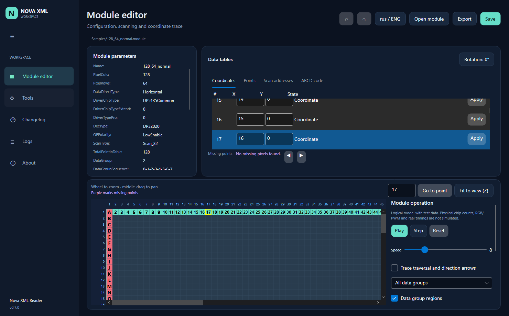

# Module XML Reader

[Русский](#русский) · [English](#english) · [Releases](https://github.com/knvnano/ModuleXmlReader/releases) · [MIT](LICENSE)



## Русский

Настольный редактор файлов LED-модулей `.module` с Avalonia UI, тёмной темой и мгновенным переключением RUS/ENG. Помогает разбирать координатную трассу, проверять модуль и готовить варианты поворота.

### Возможности

- Интерактивная сетка: номера точек, линейки, красная линия адресов, фиолетовые пропуски и разделители разрывов.
- Зум колесом, панорамирование средней кнопкой и вписывание по **Z**.
- Переход к точке по номеру; навигация по пропускам и выделение известных соседей.
- Табличный редактор X/Y с выбором точки на холсте и исходными таблицами рядом.
- Повороты на 90° с сохранением групп, последовательности адресов, нулевого адреса и заполнения таблиц.
- Undo/Redo, отдельная история действий, сравнение с эталонным `.module` и сводная диагностика.
- Ячейки кодов сканирования с различением активных адресов и заполнения.
- Логическая анимация CLK/LAT/OE и условных регистров с плавным свечением, пошаговым режимом и скоростью.
- Обход трассы со стрелками и выбор отдельной группы данных.
- Контроль изменений перед сохранением, включая новые пропуски.
- Проверка папки и создание вариантов **+0/+90/+180/+270° относительно исходного файла** в новой подпапке.
- Экспорт схемы **SVG**, отчёта **Markdown** и координат **CSV**.
- Раздельные журналы log4net: события, ошибки, диагностика.

Диагностика, сравнение, пакетная обработка и история действий находятся в разделе **Инструменты** бокового меню. Изменение строки координат или ячейки кода применяется её кнопкой **Применить**. Ctrl+Z / Ctrl+Y вне текстовых полей отменяют и повторяют действия документа; внутри поля работает его текстовая история.

### Установка

Скачайте `ModuleXmlReader-0.7.0-win-x64.zip` из [релиза](https://github.com/knvnano/ModuleXmlReader/releases/latest), распакуйте и запустите `ModuleXmlReader.Avalonia.exe`. Windows x64; .NET включён в архив. Подписи цифровым сертификатом у сборки нет.

Логи хранятся в `%LOCALAPPDATA%/ModuleXmlReader/Logs/`. Имена и пути открытых файлов могут попадать в логи и экспортируемые отчёты; проверьте их перед передачей другим людям.

### Сборка из исходников

Требуются **.NET SDK 10**, Windows для проверенной настольной сборки и доступ к NuGet при первом восстановлении зависимостей.

```powershell
dotnet build ModuleXmlReader.Avalonia.sln -c Release
dotnet test ModuleXmlReader.Avalonia.sln -c Release --no-build
dotnet run --project ModuleXmlReader.Avalonia
dotnet publish ModuleXmlReader.Avalonia -c Release -r win-x64 --self-contained true -o publish/win-x64
```

Основное решение — `ModuleXmlReader.Avalonia.sln`. Старое WinForms-решение сохранено для истории и не входит в основную сборку. Последняя локальная проверка: **121 тест**, включая UI через Avalonia Headless, реальные эталоны 0°/90°/180°/270°, отмену, пакетную обработку и экспорт.

### Ограничения

Поддерживаются равные прямоугольные группы данных. Эталонный профиль: DP5135Common, Scan_32, две группы. Другие платы требуют сверки с их эталонами. 255-255 обозначает пропуск; неизвестные физические координаты не выдумываются. Повторяющиеся координаты отмечаются предупреждением, поскольку могут зависеть от схемы.

Анимация — учебная модель с тестовыми данными, **не аппаратный эмулятор**. Из таблицы нельзя достоверно восстановить число микросхем, физическую разводку, RGB/PWM и реальные тайминги. Электрическая демонстрация ограничена Concurrent, нулевым LineBias и смещениями адресов внутри группы; при неподдерживаемой конфигурации приложение объясняет причину. SVG экспортирует весь модуль, независимо от текущего фильтра холста.

## English

A desktop `.module` editor for LED modules, built with Avalonia UI and layered MVVM. Includes a dark theme and instant Russian/English switching.

### Features

- Numbered canvas, rulers, scan-address labels, missing-point highlights and gap separators.
- Wheel zoom, middle-button panning, **Z** to fit, jump-to-point and missing-point navigation.
- Linked coordinate table, safe scan-address cell editing, rotations, undo/redo and independent action history.
- Reference-file comparison, aggregate diagnostics and a change review before saving.
- Smooth educational scan/register animation, CLK/LAT/OE indicators, trace arrows and data-group filtering.
- Folder validation and **relative +0/+90/+180/+270° variants** in a fresh output folder.
- SVG trace, Markdown diagnostic report and CSV coordinate export; separate rolling log4net logs.

Download the self-contained Windows x64 ZIP from [Releases](https://github.com/knvnano/ModuleXmlReader/releases/latest), extract it and run `ModuleXmlReader.Avalonia.exe`. No separate .NET runtime is needed. The executable is not digitally signed. Build commands above require **.NET SDK 10**. The tested release target is Windows x64; other platforms are not release-validated.

The simulation is educational, not a cycle-accurate hardware emulator. Chip counts, PCB wiring, RGB/PWM and physical timings cannot be established from the point table alone. Unknown missing-point coordinates are not fabricated. Batch rotation angles are relative to each source; exports cover the entire module. Logs and reports may contain local file paths.

## Architecture / Архитектура

| Project | Responsibility |
|---|---|
| Domain | Geometry, editor state, simulation frames, diagnostics and export records |
| Application | Validation, rotation, point/scan parsing, undo/redo, comparison and export generation |
| Infrastructure | XML persistence, batch file operations, report writing, changelog and logging |
| Presentation | ViewModels, localization, commands and dialog/timer ports |
| Avalonia | Views, canvas, rendering, desktop dialogs and composition root |
| CharacterizationTests | Regression, service and headless UI tests |

## Documentation / Документация

- [Feature implementation report](docs/FEATURE-PLAN.md)
- [Canvas navigation](docs/CANVAS.md)
- [Simulation and limitations](docs/SIMULATION.md)
- [Localization and logging](docs/INTERFACE-LOCALIZATION-LOGGING.md)
- [Migration architecture](docs/STAGE2-ARCHITECTURE.md)
- [Bug fixes and module analysis](docs/STAGE3-FIXES.md)
- [Contributing](CONTRIBUTING.md), [security reporting](SECURITY.md), [third-party notices](THIRD-PARTY-NOTICES.md)

## License

[MIT](LICENSE). Original WinForms sources are retained in `Module_XML_reader/`; original attribution and author links remain in those sources. Third-party dependencies retain their own licenses.
