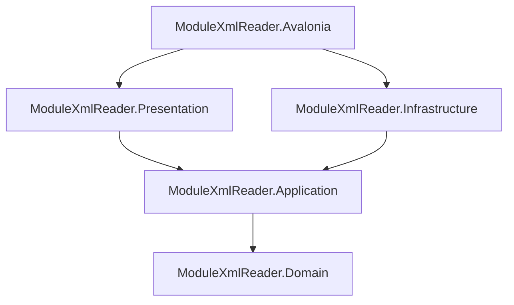

# Этап 2 — слоистая архитектура и MVVM

## Результат

Приложение переведено на MVVM без исправления известных ошибок.
Исходный WinForms-проект и `Module_XML_reader.sln` не изменены.
В production-коде больше нет `LegacySession`, `ParameterMap` и обработчиков
открытия/сохранения/поворотов в окнах. Копия LegacySession первого этапа находится
только в тестах как независимый эталон поведения.

## Слои и зависимости



| Проект | Ответственность |
|---|---|
| Domain | ModuleEditorState, ModuleParameters, PreviewData, Notice; без XML и UI |
| Application | Сценарии редактора, вычислительные сервисы и контракты хранилища |
| Infrastructure | XML, файловый ввод/вывод и запуск внешних ссылок |
| Presentation | ViewModels, INotifyPropertyChanged, команды, интерфейсы диалогов |
| Avalonia | AXAML Views, отрисовка, платформенные диалоги и composition root |
| CharacterizationTests | Проверки совместимости, ViewModels, UI и границ слоёв |

Presentation не зависит от Avalonia или Infrastructure; ViewModel можно создавать
и тестировать без графического окружения. Application не зависит от Presentation
или Infrastructure. Контракты `IModuleRepository` и `IModuleDocument` скрывают XML.
Полный XDocument остаётся в Infrastructure, поэтому сохраняются неизвестные узлы,
вложенные элементы, комментарии, атрибуты и дубликаты полей.

## Сервисы

| Компонент | Назначение |
|---|---|
| ModuleEditorService / IModuleEditorService | Открытие, сохранение и последовательность действий при поворотах |
| ModuleRotationService / IModuleRotationService | Существующие преобразования PointTableData |
| ScanCodeService / IScanCodeService | ReverseScanCode и CalculateLineBias |
| PointTableParser / IPointTableParser | Разбор последовательности чисел через int.Parse |
| MissingPixelService / IMissingPixelService | Поиск пар 255-255 и прежний текст результата |
| PreviewService / IPreviewService | Подготовка снимка для предпросмотра |
| XmlModuleRepository / IModuleRepository | Загрузка и сохранение локальных файлов |
| XmlModuleSerializer | Работа с XDocument; обновление только существующих полей |
| ExternalLinkService / IExternalLinkService | Запуск ссылки через ОС |
| AvaloniaDialogService | Реализация IFileDialogService, INotificationService, IAboutDialogService |

Валидация не добавлялась: новые проверки изменили бы поведение. Типизация координат,
ограничения размеров и новые правила согласования полей относятся к этапу 3.

## MVVM и внедрение зависимостей

MainWindowViewModel предоставляет 28 параметров, три редактируемые таблицы,
состояние предпросмотра и команды Open, Save, RotateLeft, RotateRight, About.
AboutViewModel предоставляет текст, TelegramCommand и CloseCommand.
В обоих окнах используются компилируемые привязки с x:DataType.
Code-behind содержит только InitializeComponent.

`CompositionRoot.CreateMainWindow()` собирает граф объектов с внедрением через
конструкторы. Контейнер и глобальный service locator не используются.
Один редактор и его состояние создаются на главное окно. Диалоги знают своё окно,
а ViewModels работают только с их интерфейсами. Сообщения очищаются и показываются
после обновления привязанных свойств, как на первом этапе.

ModulePreview получает PreviewData через StyledProperty. Он не читает файлы,
не вычисляет пропуски и не выполняет повороты. Его размеры, цвета, обрезка и
индексация намеренно соответствуют прежней отрисовке.

## Сохранённое поведение

- Левый поворот по-прежнему выдаёт 64 фиксированные пары.
- Правый поворот по-прежнему заменяет пары на 15-X.
- Повороты и сохранение перечитывают исходный файл.
- Поворот перезаписывает несохранённые правки таблиц прежними данными с диска.
- Путь и флаг меняются до проверки открываемого документа; возможна частичная загрузка.
- После поворотов/редактирования предпросмотр и пропуски не пересчитываются.
- Сохранение не валидирует ввод и не создаёт отсутствующие поля.
- Save As не меняет исходный путь; запросов о несохранённых изменениях нет.
- Кнопка Rotate 180 остаётся доступной без команды.
- Сохранены исходные сообщения, начальные значения полей и нормализация null в пустую строку.

Список первого этапа: [STAGE1-COMPATIBILITY.md](STAGE1-COMPATIBILITY.md).

## Проверки

43 теста:

- 18 проверок прежних алгоритмов и сценариев редактора;
- 15 сценариев полного сравнения с замороженным LegacySession первого этапа,
  включая некорректный XML, пропущенные поля, нулевые/нечисловые размеры,
  дубликаты, пространства имён, повторные повороты и отсутствующий файл;
- сохранение до открытия файла также сравнивается с первым этапом;
- 3 проверки ViewModels с подставными сервисами: отмена, команды, порядок
  обновления и уведомлений, ссылки и закрытие About;
- 4 Avalonia Headless/Skia проверки: создание окон, привязки, команды и пиксели;
- 2 проверки границ зависимостей и удаления старой логики из production UI.

Сравнение с эталоном проверяет все 28 параметров, три таблицы, путь, флаг,
предпросмотр, сообщения и точный текст сохраняемого XML.

```powershell
dotnet build ModuleXmlReader.Avalonia.sln -c Release
dotnet test ModuleXmlReader.CharacterizationTests/ModuleXmlReader.CharacterizationTests.csproj -c Release --no-build --logger "trx;LogFileName=stage2.trx"
```

Ограничения: документы синтетические. Реальные файлы NovaLCT, нативные файловые
диалоги и фактическое открытие Telegram вручную не проверялись.
